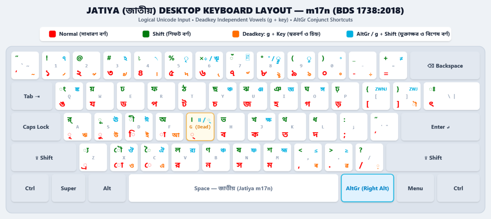

# Jatiya (জাতীয়) m17n Input Method

> Bengali input method for Linux (IBus / Fcitx via `m17n-lib`) simulating the National Keyboard Standard (Revised) **BDS 1738:2018** (BSTI), adapted for standard logical Unicode typing.

---

## 📌 Overview

This repository provides the `bn-Jatiya.mim` input method file for **m17n**, delivering an authentic **Jatiya (জাতীয়)** keyboard layout across Linux desktop environments. 

While the official desktop standard published by the Bangladesh Standards and Testing Institution (**BDS 1738:2018**) retained legacy typewriter-era visual typing habits (such as pre-Unicode visual input orders found in Bijoy), this implementation strictly adheres to canonical **Unicode logical ordering** whilst preserving standard key assignments, comprehensive deadkey combinations, and AltGr conjunct shortcuts.

---
## 🖼️ Keyboard Layout Map



---

## 🚀 Key Usability Enhancements

### 1. Logical Unicode Order vs Visual Typewriter Habits
In traditional mechanical typewriters and pre-Unicode visual layouts (such as Bijoy), letters were typed according to visual display order rather than logical spelling:
* **Legacy Visual Method (Bijoy / Typewriter):** `ে` + `ক` + `া` = `কো` or `ে` + `ক` + `ৗ` = `কৌ` (**Visual representation**)
* **Our Logical Unicode Method:** `ক` + `ো` = `কো` or `ক` + `ৌ` = `কৌ` (**Consonant + Dependent Vowel**)

In **Jatiya m17n**, input strictly follows the international Unicode standard. You type characters in the natural, phonetic order in which they are processed and encoded.

### 2. Comprehensive Deadkey Support (`g` as Virama / Hasanta)
Following the BDS 1738:2018 specification:
* Pressing `g` outputs the Virama/Hasanta (`্`) as a deadkey.
* Typing the corresponding vowel sign immediately after `g` transforms it into its full independent vowel equivalent (e.g. `g` + `f` = `আ`, `g` + `d` = `ই`, `g` + `c` = `এ`).
* Non-deadkey fallback for standalone Virama is accessible via `AltGr + g` (or `Alt + g` / `Ctrl + Alt + g`).

### 3. Rapid AltGr / Multi-Modifier Conjunct Shortcuts
Frequently used complex Bengali conjuncts can be triggered instantly without manual multi-character decomposition using `AltGr` (or `Alt` / `Ctrl+Alt`):
* `AltGr + q` ➔ **ঙ্ক**
* `AltGr + y` ➔ **ঞ্চ**
* `AltGr + u` ➔ **ঞ্জ**
* `AltGr + i` ➔ **জ্ঞ**
* `AltGr + o` ➔ **ঙ্গ**
* `AltGr + j` ➔ **ক্ষ**
* `AltGr + v` ➔ **ব়্য**
* `AltGr + b` ➔ **ঞ্চ**
* `AltGr + n` ➔ **ষ্ণ**
* `AltGr + m` ➔ **হ্ম**

---

## ⌨️ Layout Specification

### Base & Shift Layers

| Key | Normal | Unicode | Shift | Unicode | Description / Shift Character |
| :---: | :---: | :---: | :---: | :---: | :--- |
| **Q** | ঙ | `U+0999` | ং | `U+0982` | Bengali Letter NGA / Sign Anusvara |
| **W** | য | `U+09AF` | য় | `U+09DF` | Bengali Letter YA / Letter YYA |
| **E** | ড | `U+09A1` | ঢ | `U+09A2` | Bengali Letter DDA / Letter DDHA |
| **R** | প | `U+09AA` | ফ | `U+09AB` | Bengali Letter PA / Letter PHA |
| **T** | ট | `U+099F` | ঠ | `U+09A0` | Bengali Letter TTA / Letter TTHA |
| **Y** | চ | `U+099A` | ছ | `U+099B` | Bengali Letter CA / Letter CHA |
| **U** | জ | `U+099C` | ঝ | `U+099D` | Bengali Letter JA / Letter JHA |
| **I** | হ | `U+09B9` | ঞ | `U+099E` | Bengali Letter HA / Letter NYA |
| **O** | গ | `U+0997` | ঘ | `U+0998` | Bengali Letter GA / Letter GHA |
| **P** | ড় | `U+09DC` | ঢ় | `U+09DD` | Bengali Letter RRA / Letter RHA |
| **A** | ৃ | `U+09C3` | র্ | `U+09B0 U+09CD` | Vowel Sign Vocalic R / Reph Sign |
| **S** | ু | `U+09C1` | ূ | `U+09C2` | Vowel Sign U / Vowel Sign UU |
| **D** | ি | `U+09BF` | ী | `U+09C0` | Vowel Sign I / Vowel Sign II |
| **F** | া | `U+09BE` | অ | `U+0985` | Vowel Sign AA / Bengali Letter A |
| **G** | — *(deadkey)* | `U+09CD` | । | `U+0964` | Virama (Hasanta) / Devanagari Danda |
| **H** | ব | `U+09AC` | ভ | `U+09AD` | Bengali Letter BA / Letter BHA |
| **J** | ক | `U+0995` | খ | `U+0996` | Bengali Letter KA / Letter KHA |
| **K** | ত | `U+09A4` | থ | `U+09A5` | Bengali Letter TA / Letter THA |
| **L** | দ | `U+09A6` | ধ | `U+09A7` | Bengali Letter DA / Letter DHA |
| **Z** | ্র | `U+09CD U+09B0` | ্য | `U+09CD U+09AF` | Subjoined RA (Ra-phala) / Subjoined YA (Ya-phala) |
| **X** | ো | `U+09CB` | ৌ | `U+09CC` | Vowel Sign O / Vowel Sign AU |
| **C** | ে | `U+09C7` | ৈ | `U+09C8` | Vowel Sign E / Vowel Sign AI |
| **V** | র | `U+09B0` | ল | `U+09B2` | Bengali Letter RA / Letter LA |
| **B** | ন | `U+09A8` | ণ | `U+09A3` | Bengali Letter NA / Letter NNA |
| **N** | স | `U+09B8` | ষ | `U+09B7` | Bengali Letter SA / Letter SSA |
| **M** | ম | `U+09AE` | শ | `U+09B6` | Bengali Letter MA / Letter SHA |
| **\\** | ৎ | `U+09CE` | ঃ | `U+0983` | Bengali Letter Khanda Ta / Sign Visarga |

---

### Deadkey Combinations (`g` + Key)

#### 1. Independent Vowels
* `g` + `f` ➔ **আ** (`U+0986`)
* `g` + `d` ➔ **ই** (`U+0987`)
* `g` + `D` ➔ **ঈ** (`U+0988`)
* `g` + `s` ➔ **উ** (`U+0989`)
* `g` + `S` ➔ **ঊ** (`U+098A`)
* `g` + `a` ➔ **ঋ** (`U+098B`)
* `g` + `c` ➔ **এ** (`U+098F`)
* `g` + `C` ➔ **ঐ** (`U+0990`)
* `g` + `x` ➔ **ও** (`U+0993`)
* `g` + `X` ➔ **ঔ** (`U+0994`)

#### 2. Historic, Assamese, Currency & Punctuation Characters
* `g` + `G` ➔ **॥** (`U+0965` Double Danda)
* `g` + `\` ➔ **~** (`U+007E` Tilde)
* `g` + `1` ➔ **৴** (`U+09F4` Bengali Currency Numerator One)
* `g` + `!` ➔ **ঀ** (`U+0980` Bengali Anji)
* `g` + `2` ➔ **৵** (`U+09F5` Bengali Currency Numerator Two)
* `g` + `3` ➔ **৶** (`U+09F6` Bengali Currency Numerator Three)
* `g` + `#` ➔ **ঽ** (`U+09BD` Bengali Sign Avagraha)
* `g` + `4` ➔ **৷** (`U+09F7` Bengali Currency Numerator Four)
* `g` + `$` ➔ **৲** (`U+09F2` Bengali Rupee Mark)
* `g` + `5` ➔ **৸** (`U+09F8` Bengali Currency Numerator Less Than Sixteen)
* `g` + `%` ➔ **ৄ** (`U+09C4` Bengali Vowel Sign Vocalic RR)
* `g` + `6` ➔ **৻** (`U+09FB` Bengali Ganda Mark)
* `g` + `^` ➔ **ৠ** (`U+09E0` Bengali Letter Vocalic RR)
* `g` + `7` ➔ **৺** (`U+09FA` Bengali Isshar)
* `g` + `&` ➔ **ৼ** (`U+09FC` Bengali Vedic Tone Anudatta)
* `g` + `8` ➔ **ৡ** (`U+09E1` Bengali Letter Vocalic LL)
* `g` + `*` ➔ **ৣ** (`U+09E3` Bengali Vowel Sign Vocalic LL)
* `g` + `9` ➔ **ঌ** (`U+098C` Bengali Letter Vocalic L)
* `g` + `(` ➔ **ৢ** (`U+09E2` Bengali Vowel Sign Vocalic L)
* `g` + `0` ➔ **৹** (`U+09F9` Bengali Currency Denominator Sixteen)
* `g` + `)` ➔ **৽** (`U+09FD` Bengali Sign Khanda Ta)
* `g` + `-` ➔ **÷** (`U+00F7` Division Sign)
* `g` + `,` ➔ **ৰ** (`U+09F0` Assamese Letter Ra)
* `g` + `.` ➔ **ৱ** (`U+09F1` Assamese Letter Va)
* `g` + `<` ➔ **≤** (`U+2264` Less-Than or Equal To)
* `g` + `>` ➔ **≥** (`U+2265` Greater-Than or Equal To)
* `g` + `+` ➔ **≠** (`U+2260` Not Equal To)
* `g` + `/` ➔ **়** (`U+09BC` Bengali Sign Nukta)
* `g` + `]` ➔ **ৗ** (`U+09D7` Bengali Au Length Mark)

---

## 🛠️ Installation on Linux

### Prerequisites
Ensure `m17n-db`, `m17n-lib`, and your preferred input framework (`ibus-m17n` or `fcitx5-m17n` / `fcitx-m17n`) are installed:

#### Debian / Ubuntu / Linux Mint
```bash
sudo apt update
sudo apt install m17n-db libm17n-0 ibus-m17n
```

#### RHEL / Rocky Linux / AlmaLinux / CentOS Stream
Enable the EPEL repository if needed, then install:
```bash
sudo dnf install epel-release
sudo dnf install m17n-db m17n-lib ibus-m17n
```

#### Fedora
```bash
sudo dnf install m17n-db m17n-lib ibus-m17n
```

#### Arch Linux / Manjaro
```bash
sudo pacman -S m17n-db m17n-lib ibus-m17n
```

---

### Step-by-Step Setup

1. **Clone the repository:**
   ```bash
   git clone [https://github.com/ekushey-org/bangla-bsti-m17n.git](https://github.com/ekushey-org/bangla-bsti-m17n.git)
   cd bangla-bsti-m17n
   ```

2. **Copy the map file to your local or system m17n directory:**
   * *For current user only (recommended):*
     ```bash
     mkdir -p ~/.m17n.d
     cp bn-Jatiya.mim ~/.m17n.d/
     ```
   * *System-wide:*
     ```bash
     sudo cp bn-Jatiya.mim /usr/share/m17n/
     ```

3. **Restart your input framework:**
   * *For IBus:*
     ```bash
     ibus restart
     ```
   * *For Fcitx5:*
     ```bash
     fcitx5 -r
     ```

4. **Add the Input Method:**
   * Open Desktop Settings (GNOME / KDE / XFCE) or IBus / Fcitx Configuration.
   * Navigate to **Input Methods** / **Keyboard Settings**.
   * Add **Bengali** ➔ **Jatiya (m17n)**.

---

## ⚙️ Configuring the Dedicated AltGr Key

On many standard US QWERTY keyboards, the right Alt key behaves as a standard `Alt` modifier, requiring a two-finger combination (`Ctrl + Alt`) to access third-level ligatures. To enable seamless single-key access using your keyboard's physical **Right Alt** as **AltGr** (`ISO_Level3_Shift`), apply the configuration for your desktop environment:

### GNOME (Ubuntu, Fedora, Debian, RHEL)
1. Install **GNOME Tweaks** if it is not already installed:
   ```bash
   sudo apt install gnome-tweaks       # Debian / Ubuntu
   sudo dnf install gnome-tweaks       # Fedora / RHEL / Alma / Rocky
   ```
2. Open **GNOME Tweaks** and navigate to **Keyboard & Mouse** ➔ **Additional Layout Options**.
3. Expand **Key to choose the 3rd level**.
4. Check **Right Alt** (or **Right Alt never chooses 3rd level** unchecked).

Alternatively, enable it instantly from the terminal via GSettings:
```bash
gsettings set org.gnome.desktop.input-sources xkb-options "['lv3:ralt_switch']"
```

### KDE Plasma
1. Open **System Settings** ➔ **Input Devices** ➔ **Keyboard**.
2. Select the **Advanced** tab.
3. Expand **Key to choose the 3rd level**.
4. Check **Right Alt**.
5. Click **Apply**.

### XFCE / MATE / Lightweight Desktops
1. Open **Keyboard Settings** ➔ **Layout** tab.
2. In the **Key to choose the 3rd level** dropdown, select **Right Alt**.

### Instant Session Configuration via X11 (`setxkbmap`)
To immediately enable Right Alt as AltGr in your current X11 session:
```bash
setxkbmap -option lv3:ralt_switch
```
*(To make this persistent across reboots without a desktop configuration tool, append `setxkbmap -option lv3:ralt_switch` to your `~/.xprofile` or `~/.xinitrc` file.)*

---

## 📄 Licence

This layout specification and map configuration are published under the **[Creative Commons Attribution 4.0 International Licence (CC BY 4.0)](LICENSE)**.

Developed by **[Ekushey](https://ekushey.org)**. Feel free to adapt, modify, and distribute with appropriate attribution.
